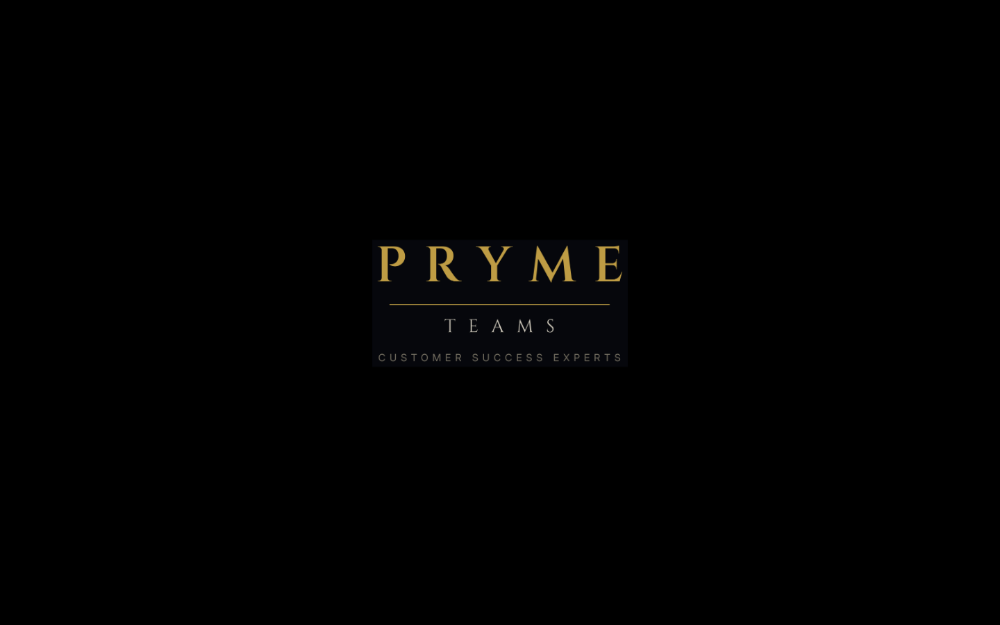
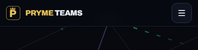
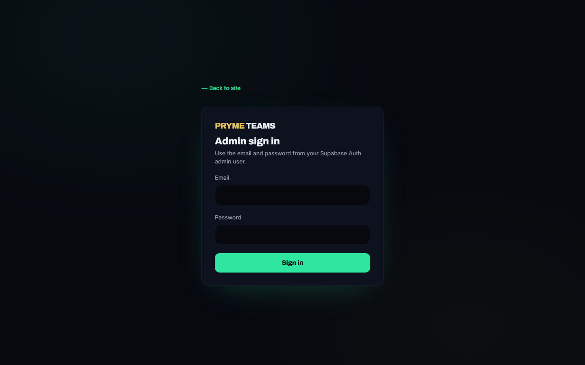
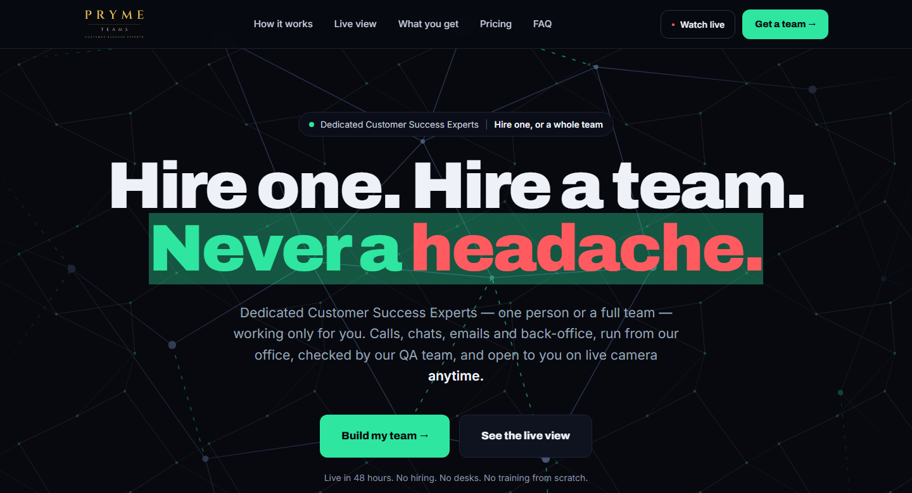
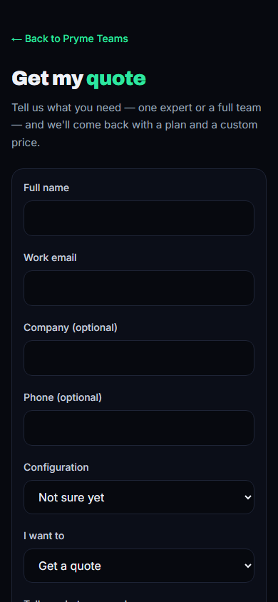
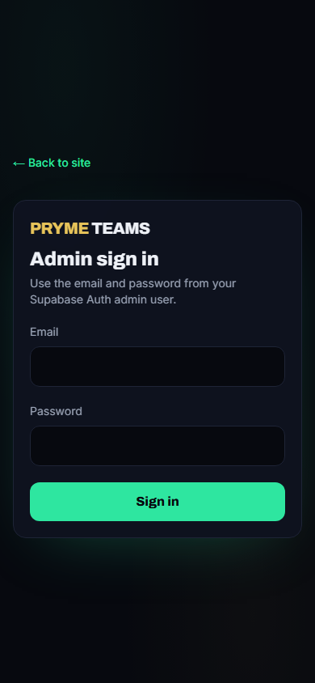
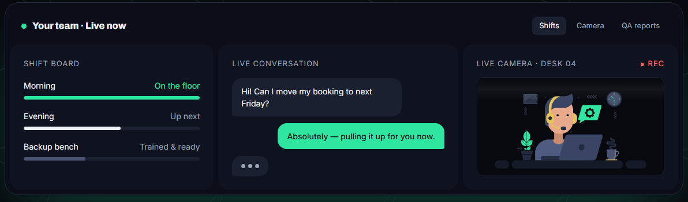
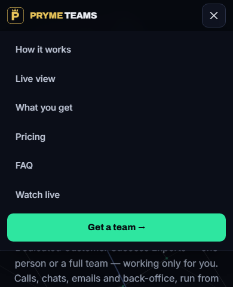
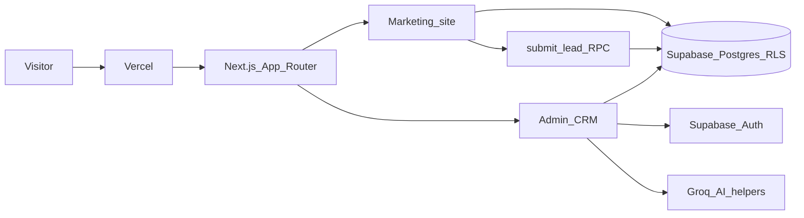

<p align="center">
  
</p>

<h1 align="center">Pryme Teams</h1>

<p align="center">
  <strong>Dedicated Customer Success Experts</strong> — hire one person or a full team.<br/>
  Same experts every shift · QA-checked · live camera access · live in 48 hours.
</p>

<p align="center">
  <a href="https://prymeteams.com"><strong>Live site → prymeteams.com</strong></a>
  ·
  <a href="https://prymeteams.com/request">Request a team</a>
  ·
  <a href="https://prymeteams.com/admin/login">Admin</a>
</p>

---

## Live demo

Product tour (~70–100s) — homepage, request flow, talent, and admin:

<video src="docs/demo/showcase.mp4" controls playsinline width="100%">
  Your browser does not support the video tag.
  <a href="docs/demo/showcase.mp4">Download MP4</a>
  ·
  <a href="docs/demo/showcase.webm">WebM</a>
</video>

### Product shots

| Marketing | Mobile | Admin |
|---|---|---|
|  |  |  |
|  |  |  |
|  |  | |

Re-record the tour with `npm run record:showcase` (set `ADMIN_EMAIL` / `ADMIN_PASSWORD` for full dashboard pages).

---

## Architecture



| Layer | Role |
|---|---|
| **Next.js 16** | App Router marketing pages + authenticated admin console |
| **Supabase** | Auth, Postgres, RLS (`is_admin()`), lead intake RPC |
| **Groq** | Admin AI assist (lead insight, job copy, talent bio) |
| **Vercel** | Production hosting for [prymeteams.com](https://prymeteams.com) |

---

## Stack

- **Next.js 16** · **React 19** · **TypeScript**
- **Tailwind CSS 4** · **Supabase** (Auth + Postgres + RLS)
- **Vitest** · **Playwright** · **Vercel**

Design source: [`handoff/`](handoff/) (Handoff v2 — floating call button, business-hours logic).

---

## Features

| Area | What’s included |
|---|---|
| Homepage | Green-on-black branding, branded preload splash, live clock, mobile nav, floating call FAB |
| Lead intake | `/request` with Zod validation, honeypot, rate-limited RPC |
| Public talent | `/talent` from approved + visible profiles |
| Admin CRM | Leads, companies, talent, jobs, placements, tasks, finance, audit, settings — full CRUD + demo seed |
| AI (Groq) | Lead insight, job description expand, talent bio polish |
| Legal | `/privacy`, `/terms` |

---

## Quick start

```bash
npm install
# create .env.local with the variables below
npm run dev
```

Open [http://localhost:3000](http://localhost:3000). The site builds without Supabase env vars (forms show a “not configured” state).

---

## Environment

Create a local `.env.local` (gitignored — never commit it):

| Variable | Purpose |
|---|---|
| `NEXT_PUBLIC_SUPABASE_URL` | Supabase project URL |
| `NEXT_PUBLIC_SUPABASE_PUBLISHABLE_KEY` | Anon / publishable key |
| `SUPABASE_SECRET_KEY` | Service role JWT (server-only; needed for `npm run seed:demo`) |
| `NEXT_PUBLIC_SITE_URL` | Canonical URL (`https://prymeteams.com`) |
| `GROQ_API_KEY` | Groq API key for admin AI helpers |

After first admin login, use **Settings → Seed demo dashboard** to load showcase CRM data.

---

## Database

**SQL schema files are intentionally excluded from GitHub.** Keep schema only on your machine or a private channel.

1. Create a Supabase project and run your private schema SQL.
2. Create an admin in **Authentication → Users**.
3. Insert that user’s UUID into `public.admin_users`.
4. Sign in at `/admin/login`.

See [`docs/deployment.md`](docs/deployment.md) for the full checklist.

---

## Scripts

| Command | Purpose |
|---|---|
| `npm run dev` | Local development |
| `npm run build` / `npm start` | Production build & serve |
| `npm test` | Vitest unit tests |
| `npm run test:e2e` | Playwright viewport QA |
| `npm run seed:demo` | Seed demo CRM data via service-role key |
| `npm run record:showcase` | Record MP4/WebM tour into `docs/demo/` |

---

## Security

- Admin routes require Supabase Auth + `admin_users` allowlist (RLS `is_admin()`).
- Public lead writes go only through the `submit_lead` RPC (Zod + honeypot + hashed IP rate limit).
- Security headers (CSP, frame deny, nosniff, referrer) in `next.config.ts`.
- Do not publish SQL, service-role keys, or real contact secrets.

---

## Docs

- [`docs/deployment.md`](docs/deployment.md)
- [`docs/verification-log.md`](docs/verification-log.md)
- [`docs/decision-log.md`](docs/decision-log.md)
- [`handoff/README.md`](handoff/README.md)

---

## License

Private / proprietary — all rights reserved unless otherwise agreed.
